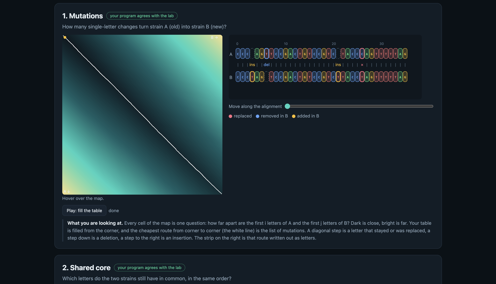
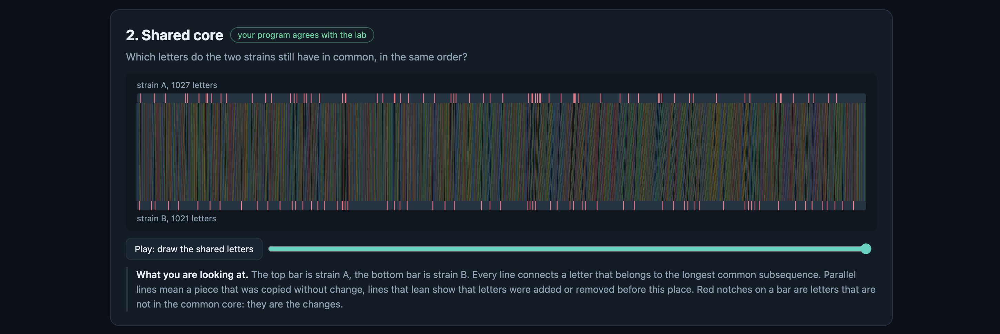
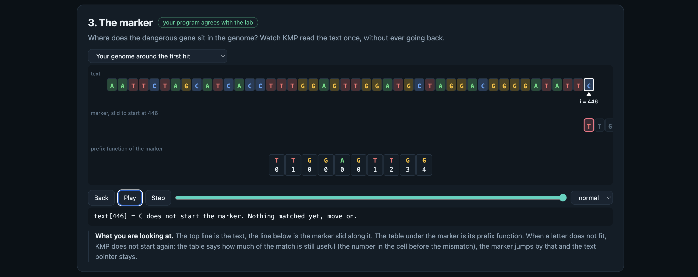
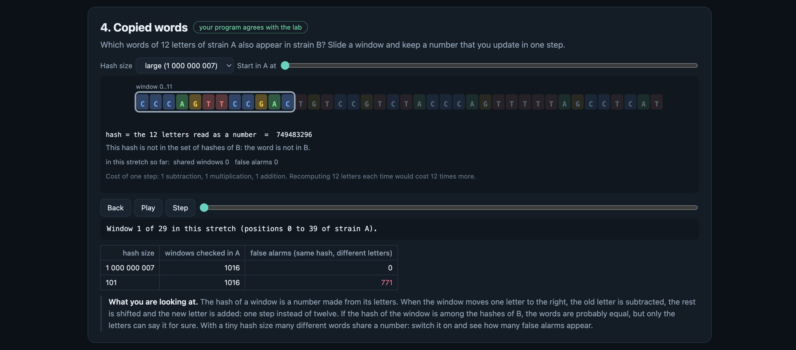
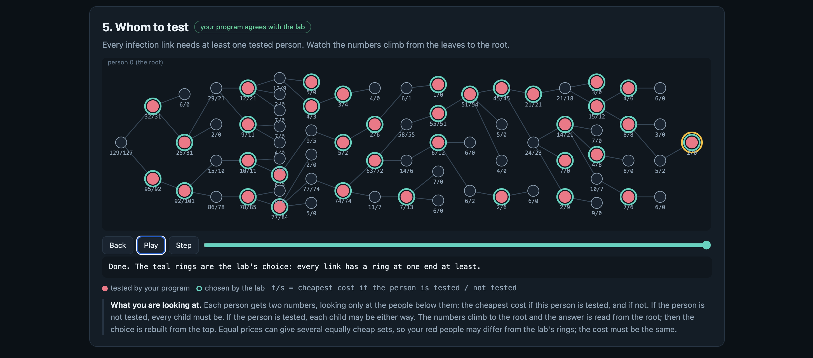

# Assignment 4. Patient Zero

Student ID: 250312
Name: Yasmina Kashtayeva
Group: SE - 2532

This file is the report. Fill it in as you go. How to start: `START_HERE.md`. The task: `docs/Assignment4.pdf`.

## Program output

The 9 lines your program prints on your data (`java -cp out Main`):

    Mutations: 108 
    Shared core: 954
    Marker hits: 5
    First hit: 417
    Border length: 4
    Shared words: 245
    Tests needed: 31
    Cheapest testing: 127
    Longest chain: 26

My outbreak report (a screenshot of `output/outbreak.html`):

## Questions

Answer in your own words, two or three sentences each.

Mission 1. What does the cell d[i][j] of your table mean, and how is it computed from other cells?
+ The cell `d[i][j]` represents the minimum edit distance (smallest number of insertions, deletions, and replacements) needed to transform the prefix of length `i` of strain A into the prefix of length `j` of strain B. It is computed from smaller subproblems: if the current characters `A[i-1]` and `B[j-1]` are identical, `d[i][j] = d[i-1][j-1]`; otherwise, it takes `1 + min(d[i-1][j-1], d[i-1][j], d[i][j-1])`, representing the best choice among substitution, deletion, or insertion.

Mission 2. How is the longest common subsequence different from the longest common substring? My Shared core is bigger than the number of letters that are the same at the same place: why?
+ A longest common substring requires characters to be strictly contiguous in both sequences, whereas a longest common subsequence (LCS) only requires characters to appear in the same relative order, allowing gaps between them. The Shared core is larger than direct positional matches because LCS accounts for insertions and deletions, aligning matching letters across shifted positions throughout the strains.

Mission 3. What does the prefix function tell you, and why does the pointer in the text never go back in KMP? What is the Border length of my marker and what does it mean?
+ The prefix function `pi[i]` gives the length of the longest proper prefix of `pattern[0..i]` that is also a suffix of `pattern[0..i]`. In KMP, the text pointer never moves backward because when a mismatch occurs after matching `k` characters, the prefix function tells us the exact longest valid overlap (`pi[k-1]`), allowing the pattern window to slide forward safely. The Border length of my marker is 4, which means the longest proper prefix of the marker that is also its suffix has a length of 4.

Mission 4. Why must you compare the letters after the hashes are equal? What happens to the cost of Rabin-Karp if many windows have the same hash?
+ Different 12-letter substrings can yield identical hash values due to hash collisions (spurious hits), so an explicit character-by-character comparison is mandatory to confirm a true match. If many windows hash to the same value, the algorithm degrades towards $O(n \cdot k)$ verification time because frequent hash collisions trigger full string comparisons for every false alarm.

Mission 5. What are the two states of a person in your DP, and how do you get the answer for a person from its children? Why does a greedy "test the person with most links first" not always give the cheapest answer?
+ The two states for a person $v$ are `dpTested[v]` (the minimum cost of $v$'s subtree given that $v$ is tested) and `dpNotTested[v]` (given that $v$ is not tested). If $v$ is tested, each child $u$ can independently choose its optimal state $\min(\text{tested}, \text{notTested})$; if $v$ is not tested, every child $u$ must be tested to ensure the infection link $(v, u)$ is covered. A greedy strategy based solely on link degree fails because it ignores non-uniform node testing costs and global tree structures, often choosing high-degree nodes with disproportionately high costs over cheaper combined coverage options.

## AI use

The syllabus requires you to say which AI tools you used and for what. Write the tool (ChatGPT, Copilot, other) and what you asked it: explain an idea, find an error, review code. Write "none" if you did not use any. If you took code or text from a book or a website, give the source here.

+ I've used Gemini for syntax checking and assurance that i did things right
## Timing (Mission 7)

Milliseconds, average of 3 runs, from `java -cp out Bench`.

| test | size | time                     |
|---|---|--------------------------|
| naive search | 20 000 / 40 000 / 80 000 | 45.2 ms / 111.6 ms / 229.0 ms |
| KMP | 20 000 / 40 000 / 80 000 |     2.9 ms / 1.8 ms / 0.5 ms     |
| edit distance | 500 / 1000 / 2000 / 4000 |            6.7 ms / 6.5 ms / 13.7 ms / 54.6 ms              |

What do the numbers say about how the time grows? When you double the size, by how much does each time grow? Two or three sentences.
+ For naive string search, doubling the text size roughly doubles the execution time ($O(n \cdot m)$ complexity), whereas KMP runs in near-instant linear time $O(n + m)$ without backtracking. For edit distance, quadrupling the input size from 1000 to 4000 increases execution time approximately by a factor of 8 to 9, demonstrating quadratic time growth $O(n \cdot m)$ as expected from standard dynamic programming grid evaluation.

## Complexity

n is the length of the text (or of a strain), m the length of the pattern, k the length of the window, v the number of people. Fill in every algorithm you wrote.

| Algorithm | Time | Space | Assumptions |
| :--- | :--- | :--- | :--- |
| **Edit distance** | $O(n \cdot m)$ | $O(n \cdot m)$ | Full 2D DP matrix for dynamic programming lookup. |
| **LCS** | $O(n \cdot m)$ | $O(n \cdot m)$ | Full 2D DP matrix for dynamic programming lookup. |
| **Prefix function and KMP** | $O(n + m)$ | $O(m)$ | Precomputed prefix array of size $m$, single linear pass over text. |
| **Rabin-Karp (shared words)** | $O(n + m)$ avg, $O(n \cdot k)$ worst | $O(m)$ | Constant hash computations using rolling hash; rare hash collisions. |
| **Tree DP** | $O(v)$ | $O(v)$ | Tree rooted at vertex 0, processed via DFS traversal. |

## Before you submit

- The four files in `data` and the screenshot `output/outbreak.png` are in the repository.
- `java tools/Check.java` shows all examples right.
- This README is filled in, the program output and the section AI use included.
- The work is pushed to main (at least one commit per mission) and the repository is public.
- The link is attached in Moodle.
